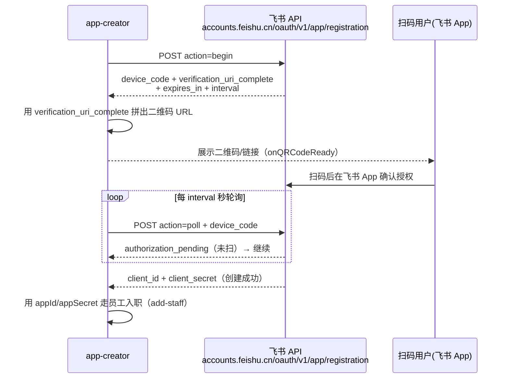

# 一键扫码创建员工 — 能力归属与实现拆解

> 日期：2026-08-19 ｜ 范围：只回答一个核心问题 —— 「扫码/链接一键创建飞书应用」到底是谁的能力、如何实现
> 相关代码：`local/workspace/tools/app-creator/server.js` ｜ `local/workspace/tools/admin/` ｜ `@larksuiteoapi/node-sdk`

---

## 一句话结论

**核心能力 = 飞书开放平台的 API（`POST /oauth/v1/app/registration`，基于 OAuth 2.0 Device Authorization Grant / RFC 8628）。**

- 项目里的 app-creator 是通过**官方 SDK**（`@larksuiteoapi/node-sdk` 的 `registerApp()`）来调用这个 API 的 —— SDK 只是对 API 的**封装**，能力本体在 API。
- **Lark CLI 不包含此能力**。CLI 的 `auth qrcode` 只是"把任意 URL 渲染成二维码图片"的通用工具；`auth login` 是用户登录授权，不是创建应用；`application` 域只管理已绑定应用的 slash command，不创建新应用。

---

## 一、三层能力对照（先分清）

| 层 | 是什么 | 与本能力的关系 | 能力 |
|---|---|---|---|
| **API** | `POST https://accounts.feishu.cn/oauth/v1/app/registration` | ✅ **能力本体**：生成设备码+验证链接、轮询扫码结果、返回 appId/appSecret | 一键注册飞书自建应用 |
| **SDK** | `@larksuiteoapi/node-sdk` 的 `registerApp()` | ✅ **封装**：把 begin/poll/二维码 URL/轮询/错误处理包装成一个 Promise 函数 | 一行代码调用 API |
| **CLI** | `lark-cli` | ❌ **不涉及**：`auth qrcode` 只渲染二维码图；`auth login` 是 OAuth 登录；`application` 只管 slash command | 无（仅通用二维码渲染工具） |

> 记忆锚点：**底层是 HTTP API → SDK 是官方封装 → CLI 无关**。

---

## 二、底层协议：RFC 8628 设备码授权

`registerApp` 不是飞书私有的花活，而是遵循标准的 **OAuth 2.0 Device Authorization Grant（RFC 8628）** 流程：



---

## 三、底层 API 细节（能力本体）

**端点**：`POST https://accounts.feishu.cn/oauth/v1/app/registration`
（Lark 国际版为 `accounts.larksuite.com`；SDK 检测到 Lark 租户会自动切换域名）
**Content-Type**：`application/x-www-form-urlencoded`

### ① action=begin —— 发起注册，拿验证链接

请求参数（SDK 实际发送，见 `es/index.js` 的 `begin()`）：

| 参数 | 值 | 含义 |
|---|---|---|
| `action` | `begin` | 发起设备码授权 |
| `archetype` | `PersonalAgent` | 注册形态：个人 Agent 应用 |
| `auth_method` | `client_secret` | 授权方式 |
| `request_user_info` | `open_id` | 需要扫码用户 open_id |

响应（`beginRes`）：

| 字段 | 含义 |
|---|---|
| `device_code` | 设备码（后续 poll 用） |
| `verification_uri_complete` | **完整验证链接**（含 user_code）→ SDK 拼上参数后即成二维码 URL |
| `expires_in` | 过期秒数（默认 600 = 1 小时） |
| `interval` | 建议轮询间隔（默认 5 秒） |

SDK 拿到 `verification_uri_complete` 后拼参数（`from`/`source`/`tp`/`name`/`desc`/`avatar`/`createOnly`…），通过 `onQRCodeReady({ url, expireIn })` 回调交给调用方。

### ② action=poll —— 轮询等待扫码结果

请求参数：`action=poll` + `device_code`

响应分支：

| 响应 | 含义 | SDK 处理 |
|---|---|---|
| `client_id` + `client_secret` | ✅ 用户扫码确认，应用创建成功 | resolve，返回凭据 |
| `authorization_pending` | 用户还没扫 | 等 interval 后继续轮询 |
| `slow_down` | 轮询太频繁 | interval +5s 继续 |
| `access_denied` | 用户拒绝 | reject |
| `expired_token` | 链接过期 | reject |

> ⚠️ RFC 8628 规定的错误（`authorization_pending`、`slow_down` 等）以 **HTTP 400** 返回，SDK 的 `requestRegistration` 专门捕获 `e.response.data` 处理，不当作网络错误。

### 返回值

```jsonc
{
  "client_id": "cli_xxx",      // App ID
  "client_secret": "xxx",      // App Secret
  "user_info": { "open_id": "ou_...", "tenant_brand": "feishu" }  // 可选
}
```

---

## 四、SDK 封装层：registerApp()

`registerApp` 把上面两个 API 动作封装成一个 Promise，并额外提供：

- **appPreset**：预设应用头像/名称/描述，扫码确认页自动预填（支持 `{user}` 占位符）
- **addons**：增量申请权限/事件/回调，预填到确认页
- **createOnly**：确认页只允许创建新应用，隐藏"选择已有应用"
- **appId**：传已有应用 → 变成"更新该应用配置/加权限"（再次扫码确认）
- **onStatusChange**：`polling` / `slow_down` / `domain_switched` 状态回调
- **AbortSignal**：支持中途取消轮询

用法示例（SDK README.zh.md）：

```typescript
import * as lark from '@larksuiteoapi/node-sdk';

const result = await lark.registerApp({
  appPreset: { name: '小文', desc: '内容运营岗位 · OpenClaw 员工机器人' },
  createOnly: true,
  onQRCodeReady(info) { console.log(`请扫码: ${info.url}`); },
});

console.log('App ID:', result.client_id);        // 直接可用
console.log('App Secret:', result.client_secret); // 直接可用
```

---

## 五、项目实际实现（app-creator）

`local/workspace/tools/app-creator/server.js`（监听 `127.0.0.1:18900`）：

1. `POST /create-app` → `startCreateApp(name, agentId, role, persona)`：
   - 建内存任务（`state: waiting`，15 分钟 TTL）
   - 调 `registerApp({ appPreset, createOnly: true, onQRCodeReady })`
   - `onQRCodeReady` 里把 `info.url` 存进 `job.qrUrl` 供前端轮询取
2. `registerApp` resolve 后：
   - `job.state = 'created'`
   - 拿 `client_id` / `client_secret` 调 `execAddStaff()` → `bash add-staff-container.sh <agentId> <appId> <secret> <role> [persona]`
3. `add-staff-container.sh` 完成"入职"：生成 AGENTS.md 人设 → 写 `openclaw.json`（agent + 飞书账号 + binding `feishu:$NAME`）→ `openclaw agents add --bind feishu:$NAME`
4. 前端（`tools/admin/web/app.js`）轮询 `GET /status/:id`，拿到 `qrUrl` 后展示授权链接，`state=created` 即提示成功

---

## 六、验证方式（自行复现）

1. 启动 app-creator：`cd local/workspace/tools/app-creator && node server.js`
2. 发起创建：
   ```bash
   curl -s -X POST http://127.0.0.1:18900/create-app \
     -H 'Content-Type: application/json' \
     -d '{"name":"测试员工","role":"researcher"}'
   # → {"ok":true,"requestId":"...","agentId":"ce-shi-yuan-gong"}
   ```
3. 轮询拿二维码 URL：
   ```bash
   curl -s http://127.0.0.1:18900/status/<requestId>
   # → state=waiting, qrUrl=https://accounts.feishu.cn/...  ← 这个 URL 即二维码
   ```
4. 手机飞书扫码确认 → 再轮询 → `state=created` + `appId/appSecret`

> 抓包看底层 API：直接对 `POST https://accounts.feishu.cn/oauth/v1/app/registration` 发 `action=begin` 即可观察到 device_code/verification_uri_complete，与 SDK 行为一致。

---

## 七、关键文件索引

| 文件 | 作用 |
|---|---|
| `local/workspace/tools/app-creator/server.js` | 扫码创建应用服务（调用 SDK） |
| `local/workspace/tools/app-creator/node_modules/@larksuiteoapi/node-sdk/es/index.js` | `registerApp` 实现（L103163 起），`ENDPOINT` 定义在 L103019 |
| `local/workspace/tools/app-creator/node_modules/@larksuiteoapi/node-sdk/README.zh.md` | SDK 官方文档（L715 起「一键创建应用」） |
| `local/workspace/tools/admin/server.js` | 管理后台后端，转发 `/api/connect` |
| `local/workspace/tools/admin/lib/appcreator.js` | 对 app-creator 的 HTTP 客户端封装 |
| `local/workspace/tools/admin/web/app.js` | 前端 3 步向导 + 轮询 |
| `local/workspace/tools/add-staff-container.sh` | 拿到 appId/secret 后的员工入职脚本 |
