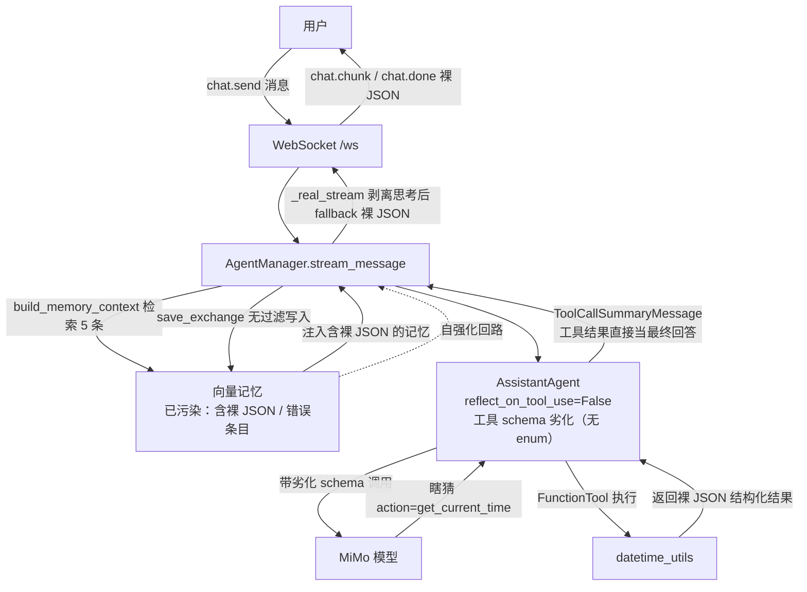
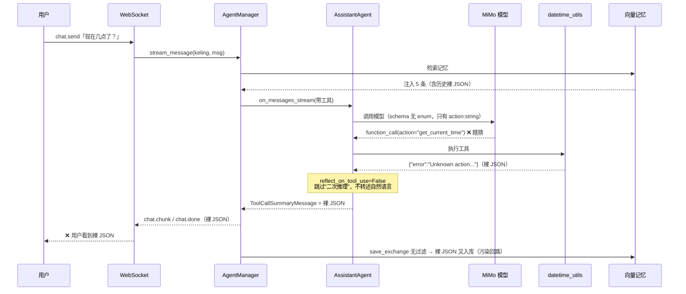
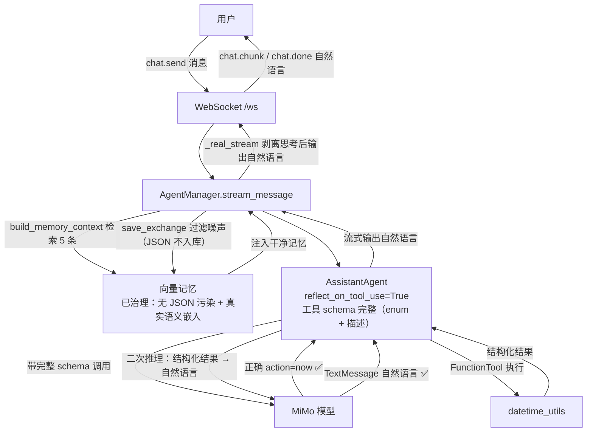
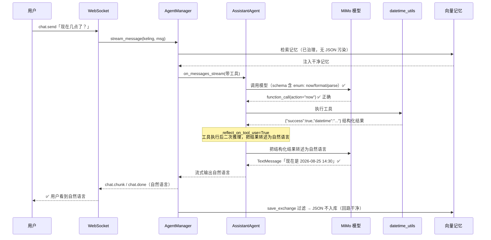

# 复盘：聊天工具调用返回裸 JSON 问题与最终修复方案

> 日期：2026-08-25
> 模块：后端 Agent 引擎（AG2 集成）/ 工具调用链路 / 长期记忆
> 影响范围：全部绑定工具的 Agent（可灵、小研），DM 聊天与流式回复
> 状态：已定位、已复现、已给出最终修复方案（待实施）
> 结论一句话：**问题不是模型"变笨"，而是架构三层缺陷叠加——① 工具结果→自然语言"翻译层"缺失（依赖框架隐式默认值）；② 工具元数据双轨制、schema 劣化；③ 记忆系统无内容治理，形成错误自强化回路。**

---

## 一、问题现象（用户视角时间线）

| 时间 | 消息 | Agent | 回复 |
|---|---|---|---|
| 13:11:04 | 「你能看时间吗」 | 可灵 | `{"success": true, "datetime": "2026-08-22 13:11:04", ...}`（裸 JSON） |
| 13:11:34 | 「看来可以 不过这个输出格式不太友好」 | 可灵 | 再次返回裸 JSON（`datetime` 变为 `2026年08月22日 13:11`，带 `\u` 转义） |
| 13:14:00 | 「哈喽」 | 小研 | 再次返回时间裸 JSON |
| 13:17:32 | 「你为什么给我回复时间信息 我在和你打招呼」 | 小研 | `[Agent 调用出错: RemoteProtocolError: peer closed connection without sending complete message body (incomplete chunked read)]` |

**核心现象**：① 一旦触发时间工具调用，模型把工具返回的原始 JSON 直接当作最终回答发给用户；② 之后多轮对话（含其他 Agent）反复返回同样的 JSON；③ 某次上游模型流式连接中途断开，整条消息失败。

---

## 二、排查过程（逐步证据链）

### 2.1 定位时间工具来源
- `backend/app/tools/builtin.py` 的 `datetime_utils` 是唯一时间工具，返回 `json.dumps({...})` 结构化 JSON（默认 `ensure_ascii=True`，产生 `\u` 转义）。
- 前端看到的两条 JSON（一条 `2026-08-22 13:11:04`、一条 `2026年08月22日 13:11` 带 `\u` 转义）**正是该工具的原始返回值** → 模型是把工具输出原样回显，且第二次还用了不同的 `format` 参数（说明模型确实再次调用了工具）。

### 2.2 查记忆库 → 发现污染
- 可灵记忆（52 条）中混入大量工具原始输出/错误：
  - `{"error": "Unknown action: get_current_datetime"}`（02:36、02:40）
  - `{"error": "Unknown action: get_current_time"}`（13:07）
  - `{"query": "FastAPI 是什么...", "results": [...]}`（web_search 回显）
  - `{"success": true, "datetime": "2026-08-22 13:11:04", ...}`（13:11）
- 小研记忆（6 条）同样：`{"error": "Unknown action: get_current_date"}`、时间成功 JSON、`[Agent 调用出错: RemoteProtocolError...]`。
- **证据**：`save_exchange()` 把"用户消息 + assistant 回复"无差别写入向量记忆，工具原始 JSON 与错误信息全被当成长期记忆落库。

### 2.3 查 schema → 发现双轨制
- `ToolRegistry` 里 `datetime_utils` 的完整元数据：`action` 带 `enum: ["now","format","parse"]` 和详细描述。
- 但 `registry.get_ag2_tools()` 构造 AG2 `FunctionTool` 时**只传了 `func/name/description`**（该版本签名 `FunctionTool(func, description, name=None, global_imports=[], strict=False)` 没有 schema 参数），schema 由函数签名自动生成。
- 容器内实测模型真正收到的 schema：

```jsonc
// 模型实际看到的（劣化版）：enum 和参数描述全部丢失
"action": { "description": "action", "type": "string" }
// ToolRegistry 里的完整定义（模型看不到）
"action": { "description": "Action: 'now' ...", "enum": ["now","format","parse"] }
```

#### 补充：什么是「双轨制」？它是不是兜底方案？

**不是有意的兜底方案，恰恰相反，它是系统里一个无意的架构裂缝。** 拆开讲：

同一份工具（如 `datetime_utils`），在系统里被投影成**两份互不同步的定义**：

| | 哪来的 | 内容 | 谁消费 |
|---|---|---|---|
| **A 轨（管理面）** | `ToolRegistry` + `ToolParameter`，AiCumi 手写的元数据 | enum、参数描述、类型、必填、默认值，很完整 | 前端工具箱 UI、`/api/tools`、REST 测试执行 |
| **B 轨（运行时）** | AG2 `FunctionTool` **从 Python 函数签名自动推断** | 只剩 `action: string`，enum 和描述全丢 | **模型**（运行时唯一真正重要的消费者） |

**为什么会这样？** 正常流程应该是"定义一份工具元数据 → 直接转成 AG2 FunctionTool schema → 给模型"。但实际：

```python
ag2_tool = FunctionTool(
    func=tool_def.func,              # 只传了函数
    name=tool_def.name,              # 和名字
    description=tool_def.description,  # 和一句话描述
)                                    # ← 精心定义的 ToolParameter 在这里被丢掉了
```

而这个版本的 AG2 `FunctionTool` 构造函数**根本没有 `schema` 参数**，它只能退而求其次**自己从函数签名推断**。于是：
1. 你精心定义的 A 轨（enum/描述）没有传给模型；
2. AG2 从贫瘠的签名猜出 B 轨（劣化版）；
3. 两套没有同步机制 → 只要改一边，另一边就漂移。

**结论**：唯一沾边"兜底"的是 AG2"没收到 schema 参数就自动推断"这个行为——但正是这个兜底**制造了双轨**，而且质量很差（丢了 `enum: ["now","format","parse"]`），直接把模型带沟里（它只能瞎猜 `get_current_time`）。所以准确说法是：

> 双轨制 = **一份工具定义在两个地方各维护一份、且不同步**。它是"单一数据源原则被破坏"的后果，不是有意设计的冗余或容错。修复（见模块二）就是让两轨**同源于签名注解**，双轨合一。

### 2.4 容器内实测复现（决定性证据）
在运行中的 `aicumi-chat-server-1` 容器内，用与线上完全相同的配置（MiMo-v2.5、同一工具）跑真实推理：

```
EVENT: ModelClientStreamingChunkEvent   ← 模型思考：猜测 action 取值
  "我可以使用 datetime_utils 工具，action 参数应该是 get_current_time 或类似的"
  "可能的 action 有 get_current_time、get_current_date 等，让我先试试 get_current_time"
EVENT: ToolCallRequestEvent              ← 发起工具调用 action="get_current_time"
EVENT: ToolCallExecutionEvent            ← 工具执行 → 返回 {"error": "Unknown action: get_current_time"}
EVENT: Response
  chat_message: ToolCallSummaryMessage   ← 最终回答 = 裸工具结果 JSON
```

**两个关键事实**：
1. 模型在推理时明确说"可能 action 是 now、get_current 或 current"——**它根本不知道合法枚举值**（schema 丢了 enum）。
2. 工具执行后**没有任何自然语言后续输出**，AG2 直接把工具结果包成 `ToolCallSummaryMessage` 当最终回答。

### 2.5 查 AG2 源码 → 锁定主因
`autogen-agentchat 0.7.5 / autogen_core 0.7.5 / ag2 1.0.2`，`_assistant_agent.py:842-848`：

```python
if self._output_content_type is not None and reflect_on_tool_use is None:
    self._reflect_on_tool_use = True
elif reflect_on_tool_use is None:
    self._reflect_on_tool_use = False   # ← AiCumi 走这里
```

`_build_agent_instance()` 构造 `AssistantAgent` 时**未传 `reflect_on_tool_use`、也未设置 `output_content_type`** → 默认 `False`。源码 `:1302-1303` 与 `:1507`：

```python
if reflect_on_tool_use:                        # True：做第二次模型推理，输出自然语言
    async for ... in cls._reflect_on_tool_use_flow(...)
else:                                          # False：直接生成工具结果摘要
    # 按 tool_call_summary_format='{result}' 生成 ToolCallSummaryMessage
```

即：**`reflect_on_tool_use=False` → 工具执行后跳过"再次调用模型生成自然语言总结"，直接拿 `{result}` 当最终回答**。随后 `_real_stream()` 剥离全部思考内容（`streamed_chars==0`），走 fallback 把 `fallback_content`（即裸 JSON）发给前端。

### 2.6 确认 RemoteProtocolError 性质
- `httpx 0.28.1` + MiMo 流式端点（`https://api.xiaomimimo.com/v1`）中途断连：`peer closed connection without sending complete message body (incomplete chunked read)`。
- 属于**上游模型服务瞬时网络故障**，与 JSON 问题相互独立，但会让整条消息直接失败（`_real_stream` 异常处理输出 `[Agent 调用出错: ...]`）。
- 容器日志确认：`⚠️ real stream error for xiaoyan: peer closed connection...`。

---

## 三、根因分析（四条，按因果排序）

### 根因①（主因）：工具结果 → 自然语言"翻译层"缺失
正确闭环应为 `用户消息 → 模型决定调工具 → 执行工具 → 结构化结果 → 模型转述为自然语言 → 返回`。但当前依赖 AG2 的隐式默认 `reflect_on_tool_use=False`，**第 5 步（结构化结果 → 自然语言）被整体跳过**，工具结果直接成为最终回答。
- 本质：产品体验依赖第三方框架的隐式默认值，且该默认值（False）是给"纯工具执行"场景设计的，对"聊天产品"恰好是错的（应为 True）——**框架假设 ≠ 产品假设，未显式对齐**。

### 根因②（放大因素）：工具元数据双轨制，schema 劣化
系统存在两套工具定义且不同步：
| 定义 | 内容 | 消费者 |
|---|---|---|
| `ToolRegistry` / `ToolParameter` | 完整：enum、类型、描述 | 管理面（前端工具箱、API 展示） |
| AG2 `FunctionTool`（签名自动生成） | 劣化：`action: string`、无 enum | **模型（运行时唯一真正重要的消费者）** |

`get_ag2_tools()` 丢失 enum 与参数描述 → MiMo 只能瞎猜 `get_current_time` 等错误 action → 错误 JSON → 被回显。
- 本质：**单一数据源原则被破坏**，同一份工具定义有两个不一致的投影，模型拿到劣化版。

### 根因③（"一直返回 JSON"的粘性来源）：记忆系统无内容治理，形成自强化回路
`save_exchange()` 把**任意** assistant 回复（含工具 JSON、错误信息、失败消息）写入向量记忆。之后每轮 `build_memory_context()` 检索 5 条注入 prompt（UI 显示"已关联 5 条记忆"）→ 模型看到历史 JSON 工具输出 → 被诱导继续调工具并回显 → 再次落库 → 循环强化。
- 可灵、小研都绑了 `datetime_utils`、共用同一 MiMo client、共享同一套记忆注入逻辑 → **跨 Agent 复现**（各自独立污染，同因同果）。
- 额外发现：`embedding_available: false`（未配置真实 embedding，走本地 hash 嵌入）→ 检索区分度低、泛查询命中率高 → 进一步加剧"每轮都检索到 JSON"。

### 根因④（独立故障）：流式上游断连
MiMo 流式端点（`api.xiaomimimo.com`）经 httpx 访问时中途断连，`_real_stream` 未做重试/友好降级，整条消息失败并透出裸异常。

---

## 四、当前系统该问题板块的评价（改造前）

| 维度 | 现状评价 | 评分 |
|---|---|---|
| 工具调用闭环 | ❌ 缺"结构化结果→自然语言"翻译层，工具结果直达用户 | ★☆☆☆☆ |
| 工具元数据 | ❌ 双轨制，管理面 schema 与运行时 schema 漂移，模型拿劣化版 | ★★☆☆☆ |
| 记忆系统 | ❌ 无写入治理（流水即记忆）+ 无真实语义嵌入，错误自强化 | ★★☆☆☆ |
| 流式链路 | ❌ 手工剥离思考标签 + 裸 fallback，展示层/引擎层职责混杂 | ★★★☆☆ |
| 工具使用策略 | ❌ 无护栏，模型自由决定何时用工具（寒暄也调时间工具） | ★★☆☆☆ |
| 错误容错 | ❌ 上游断连直接透出裸异常 | ★★☆☆☆ |

**总体评价**：功能可跑通（P0/P1 演示无碍），但**"工具调用"这一核心 Agent 能力的产品级闭环不完整**，属于典型的"框架默认行为未对齐 + 元数据单一数据源破坏 + 记忆缺治理"三合一架构债。只要模型稍有工具调用，缺陷就会暴露。

### 4.1 改造前：架构图



### 4.2 改造前：时序图（以「现在几点了？」为例）



---

## 五、最终修复方案（完整设计）

> 说明：本方案为**一套完整的最终设计**，五个模块一次落地，修复后工具调用、记忆、流式容错三个子系统的架构缺陷一并消除。所有改动集中在后端，前端无需改动（协议不变）。

### 模块一：补齐「工具结果 → 自然语言」翻译层（主修复）

**文件**：`backend/app/agents/agent_manager.py`

**改动 1**：`_build_agent_instance()` 构造 `AssistantAgent` 时显式开启 `reflect_on_tool_use=True`，让"工具执行后二次推理生成自然语言总结"成为**显式契约**：

```python
return AssistantAgent(
    name=name or agent_id,
    model_client=client,
    model_client_stream=self.model_client_stream,
    system_message=info.get("persona") or "",
    description=f"{info.get('name', agent_id)} - {info.get('role', 'assistant')}",
    tools=agent_tools if agent_tools else [],
    reflect_on_tool_use=True,   # 关键：工具执行后强制模型把结构化结果转述为自然语言
)
```

**改动 2（防御兜底）**：`_real_stream()` 中，若最终 `fallback_content` 仍疑似裸工具结果（以 `{`/`[` 开头且可解析为 JSON），不直接透传，改为友好包装提示（"已获取结果，但模型总结失败"）或触发一次小型总结调用，**杜绝"结构化数据直通用户"**。

**效果**：模型拿到工具结果后一定会再生成一轮自然语言回答；`ToolCallSummaryMessage` 不再成为最终回复。

### 模块二：工具 Schema 单一化，从源头消除双轨制

**文件**：`backend/app/tools/builtin.py`（主）、`backend/app/tools/registry.py`（校验）

**核心思路**：以**函数签名注解为单一真相**，让 AG2 自动生成的 schema 天然携带 enum 与描述（已在容器内实测验证可行，AG2 支持 `Literal` → `enum`、`Annotated` → `description`）。`ToolRegistry` 元数据与 AG2 schema 同源于签名，永不漂移。

**改动 1**：内置工具函数签名改为 `Literal` + `Annotated`：

```python
from typing import Literal, Annotated, Optional

# datetime_utils
def datetime_utils(
    action: Literal["now", "format", "parse"],   # → schema 自动带 enum
    value: Annotated[Optional[str], "要格式化的时间戳或要解析的日期串（format/parse 必填）"] = None,
    format: Annotated[str, "日期格式（默认 %Y-%m-%d %H:%M:%S）"] = "%Y-%m-%d %H:%M:%S",
) -> str:
    ...

# web_search
def web_search(
    query: Annotated[str, "搜索关键词"],
    num_results: Annotated[int, "返回结果数（默认 5）"] = 5,
) -> str:
    ...

# code_execute / file_read / file_write / json_parse 同理
```

改造后模型看到的 schema（实测输出）：

```jsonc
"action": { "enum": ["now", "format", "parse"], "type": "string", "description": "action" },
"format": { "default": "%Y-%m-%d %H:%M:%S", "description": "日期格式（默认 %Y-%m-%d %H:%M:%S）", "type": "string" }
```

**改动 2（防漂移）**：`registry.py` 的 `register()` 增加一致性校验——比对 `ToolParameter` 声明与签名派生 schema 是否一致（字段、类型、enum），不一致时打印警告。可选方向：让 `ToolParameter` 直接从签名注解派生，彻底消除第二份手写元数据。

**效果**：模型明确知道 `action` 合法值为 `now/format/parse`，不再瞎猜；管理面 schema 与运行时 schema 一致。

### 模块三：记忆系统内容治理 + 检索质量

**文件**：`backend/app/agents/agent_manager.py`（写入守卫）、`backend/app/memory/vector_memory.py`（可选升级）、`scripts/`（存量清理）

**改动 1（写入守卫）**：`save_exchange()` 落库前过滤"噪声内容"：

```python
def _is_memory_noise(content: str) -> bool:
    s = (content or "").strip()
    if not s:
        return True
    if s.startswith("[Agent 调用出错") or "Unknown action" in s:
        return True
    if s[:1] in ("{", "["):
        try:
            json.loads(s)
            return True          # 工具原始输出 / 结构化 JSON，不落记忆
        except Exception:
            pass
    return False
```

只保存"用户侧有价值信息 + 模型自然语言回复"；工具 JSON、错误、失败消息一律不落库。

**改动 2（存量清理）**：新增管理脚本 `scripts/clean_memory_noise.py`（或复用现有 `/api/memory/{agent_id}/list|clear` + `DELETE /api/memory/{id}`）：
- 遍历 `VectorMemory` 全部条目，按 `_is_memory_noise` 过滤删除已污染条目；
- 可选：对清理后数量做统计报表。

**改动 3（检索质量升级，建议）**：当前 `embedding_available: false`（本地 hash 嵌入，区分度低）。建议配置真实 embedding（OpenAI / DashScope 均已有模型配置），并将记忆按 `memory_type`（fact / preference / conversation）分层沉淀，进一步降低泛查询命中噪声。

**效果**：记忆库只沉淀有价值信息，错误自强化回路被切断；存量污染被清除。

### 模块四：工具使用策略层（护栏）

**文件**：`backend/app/agents/agent_manager.py`

在 `_build_agent_instance()` 的 `system_message` 末尾统一拼接工具使用准则：

```python
TOOL_USE_POLICY = (
    "工具使用准则：\n"
    "1. 只有用户需求确实需要时才调用工具；日常寒暄、打招呼等无需调用工具。\n"
    "2. 工具返回的是结构化结果，必须用自然语言向用户转述，禁止把 JSON 直接发给用户。\n"
    "3. 工具调用失败时，用自然语言向用户友好说明，不要回显原始错误。\n"
)
```

**效果**：工具选择从"模型自由发挥"变为"有产品层约束"，寒暄不再触发时间工具。

### 模块五：流式网络容错

**文件**：`backend/app/agents/agent_manager.py`（`_real_stream`）

- 对 httpx 连接类异常（`RemoteProtocolError`、`ReadError`、`ConnectError`）做 **1 次自动重试**（整轮重发）；
- 仍失败时输出友好文案："模型服务暂时不可用，请稍后重试"，**不再透出裸异常**。

---

## 六、升级改造后的评价（对比）

| 维度 | 改造前 | 改造后 |
|---|---|---|
| 工具调用闭环 | ❌ 结构化结果直达用户 | ✅ 结构化结果 → 自然语言转述，闭环完整 |
| 工具元数据 | ❌ 双轨制、schema 劣化、模型瞎猜 | ✅ 单一数据源（签名即真相），enum/描述齐备 |
| 记忆系统 | ❌ 流水即记忆、无治理、错误自强化 | ✅ 写入治理 + 存量清理 + 真实语义嵌入 |
| 工具使用策略 | ❌ 无护栏，寒暄也调工具 | ✅ 明确准则，可预期、可控 |
| 流式链路 | ❌ 手工剥离 + 裸 fallback，脆弱 | ✅ 显式契约 + 兜底 + 容错 |
| 错误容错 | ❌ 上游断连透出裸异常 | ✅ 重试 + 友好降级 |

**改造后总体评价**：工具调用从"能跑但不可靠"升级为"产品级闭环"——模型行为可预期（何时用工具、如何转述结果都有契约约束），记忆系统回到"知识沉淀器"定位，流式链路健壮。同类问题（任何返回 JSON 的工具：`web_search`、`code_execute`、`file_read` 等）一并根治，不再依赖模型"恰好表现好"。

### 6.1 改造后：架构图



### 6.2 改造后：时序图（以「现在几点了？」为例）



---

## 七、验收标准

1. 问可灵「现在几点了」→ 返回自然语言（如"现在是 2026-08-25 14:30"），**无 JSON 回显**。
2. 对可灵/小研说「哈喽」→ 自然问候，**不调用工具**。
3. 触发任意工具（时间/搜索/代码）后，回复一定是自然语言转述。
4. 记忆库（`/api/memory/stats` + `list`）不再新增 JSON / 错误 / `[Agent 调用出错]` 条目；存量污染已清理。
5. 连续多轮对话 + 切换 Agent 不再复现"反复返回同一 JSON"。
6. 模拟/触发上游断连时：自动重试或输出友好文案，不出现裸异常。
7. 回归：普通闲聊（问候、介绍、1+1）仍正常；群聊、工作流、REST 发送不受影响。

---

## 八、附录：涉及文件与改动清单

| 文件 | 改动 |
|---|---|
| `backend/app/agents/agent_manager.py` | `reflect_on_tool_use=True`；`_real_stream` 兜底 + 重试 + 友好错误；`save_exchange` 写入守卫；`TOOL_USE_POLICY` |
| `backend/app/tools/builtin.py` | 6 个内置工具函数签名改 `Literal`/`Annotated` |
| `backend/app/tools/registry.py` | register 一致性校验（防 schema 漂移） |
| `scripts/clean_memory_noise.py`（新增） | 存量记忆污染清理 |
| `backend/app/config.py` / 环境变量（可选） | 启用真实 embedding key |

**实施顺序**：模块一 → 模块二 → 模块三 → 模块四 → 模块五 → 存量清理 → 按第七节验收。
